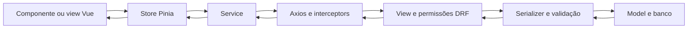

# Integração entre front e back — SINUCA

Revisão inicial: 03/11/2026; atualização de permissões e uploads em 11/11/2026. Escopo: os oito services, os nove stores, o cliente Axios, os consumidores Vue e as rotas da API Django dos dois repositórios locais. A análise dos contratos é estática, complementada pelos testes descritos ao final. Ela não equivale a testar cada operação em produção.

## Como as camadas se relacionam



O service devolve `response.data`; ele não transforma os contratos nem conserva estado. O store mantém listas e objetos reativos para as telas. O back decide permissões, isolamento de delegações e persistência. Esconder um botão ou mudar `userType` no navegador não concede nem retira permissões do servidor.

Em [main.js](../../src/main.js), o plugin Axios configura a mesma instância importada pelos services. [axios.js](../../src/plugins/axios.js) fixa a base na API publicada, acrescenta o access token salvo em `localStorage` e tenta renovar respostas 401. **Executar o front local normalmente ainda aponta para o back publicado.** Nos testes desta revisão, todas essas chamadas foram interceptadas e encaminhadas ao Django de teste em memória.

Os caminhos abaixo começam com `/api`. O Axios combina tanto `/tarefas/` quanto `turmas/1` com a base `/api`; a ausência da primeira barra no segundo caso não remove o prefixo. Alguns métodos de detalhe omitem a barra final e provocam redirecionamento para a rota do Django com barra. Esse 301 foi observado em `/paises/1` no teste de navegador.

## Inventário completo dos services e stores

| Service e store | Métodos do service e API | Estado e consumidores |
| --- | --- | --- |
| [userService](../../src/services/userService.js), [userStore](../../src/stores/userStore.js) | `login`: POST `/token/`; `refreshToken`: POST `/token/refresh/`; `register`: POST `/registro/`; `getUser`: GET `/usuarios/me/`; `getUsers`: GET `/usuarios/`; `getPendingUsers(page)`: GET `/usuarios/pendentes/?page=N`; `approveUser(id, countryId)`: POST `/usuarios/{id}/aprovar/` | Sessão, perfil, colegas e alunos pendentes. Usado por login, cadastro, guard de rotas, sidebar, formulário de tarefa e estado de aprovação. Os dois métodos administrativos novos estão disponíveis no store; a tela administrativa completa ainda não existe. |
| [taskService](../../src/services/taskService.js), [taskStore](../../src/stores/taskStore.js) | `getTasks`: GET `/tarefas/`; `getTask`: GET `/tarefas/{id}/`; `createTask`: POST na coleção; `updateTask`: PATCH no detalhe; `deleteTask`: DELETE no detalhe | Lista e formulário de tarefas. Consumidos por `TasksListComponent`, `CreatTaskModal` e playground. O back filtra tarefas pelo país do criador, com acesso global para superusuário. |
| [categoryService](../../src/services/categoryService.js), [categoryStore](../../src/stores/categoryStore.js) | `getAllCategorys`: GET `/categorias/`; `getCategory`: GET `/categorias/{id}` | `getCategories` carrega a lista; o store também fornece ícones/cores por ID. Quadro e formulário de tarefas usam esse estado. O método de detalhe do service não tem ação correspondente no store atual. |
| [countryService](../../src/services/countryService.js), [countryStore](../../src/stores/countryStore.js) | `getAllCountrys`: GET `/paises/`; `getCountry`: GET `/paises/{id}` | Lista e país selecionado. Banner da delegação e países do debate usam o mesmo store. `DelegationView` mantém uma cópia do próprio país para evitar que consultas do debate substituam seu banner. |
| [gangService](../../src/services/gangService.js), [gangStore](../../src/stores/gangStore.js) | `getGangs`: GET `/turmas/`; `getGang`: GET `/turmas/{id}` | Turmas do cadastro e consultas de detalhe. `RegisterStepThree` usa a listagem. |
| [postService](../../src/services/postService.js), [postStore](../../src/stores/postStore.js) | `getPosts`: GET `/postagens/`; `getPost`: GET `/postagens/{id}/`; `createPost`: POST; `updatePost`: PATCH; `deletePost`: DELETE | Lista e objeto de postagem. `BoardView` consome a lista; o playground também usa o store. Escritas exigem organizador ou superusuário desde S03. |
| [scheduleService](../../src/services/scheduleService.js), [scheduleStore](../../src/stores/scheduleStore.js) | `getSchedules`: GET `/cronogramas/`; `getSchedule`: GET `/cronogramas/{id}/`; `createSchedule`: POST; `updateSchedule`: PATCH; `deleteSchedule`: DELETE | Cronogramas e detalhe de atividade. Lista e modal usam os dados; playground possui chamadas de teste. O back restringe objetos por país, com exceção para superusuários. |
| [linkService](../../src/services/linkService.js), [linkStore](../../src/stores/linkStore.js) | `getLinks`: GET `/docs/`; `getLink`: GET `/docs/{id}/`; `createLink`: POST; `updateLink`: PATCH; `deleteLink`: DELETE | Documentos representados por links. Lista de documentos, item, modal de cronograma e playground usam esse estado. O back restringe objetos por país, com exceção para superusuários. |
| Sem service: [statusStore](../../src/stores/statusStore.js) | Nenhuma chamada HTTP | Calcula “a fazer”, “em andamento” e “concluído” filtrando a lista do `taskStore` pelos números 1, 2 e 3. Não grava mudanças de status no servidor. |

`userStore.uploadImage` é uma exceção à separação: envia `FormData` diretamente pelo Axios para POST `/media/images/`, sem um service próprio. Agora exige login e não é usado pelo cadastro, que envia a foto junto ao registro. O refresh automático também é feito diretamente pelo interceptor, embora exista `userService.refreshToken`.

## Contratos que as telas precisam respeitar

### Listas paginadas

O [paginador](../../../SINUCA-BACK/app/pagination.py) devolve:

```json
{"page": 1, "page_size": 10, "total_pages": 2, "results": []}
```

Por padrão são dez itens; `page_size` pode chegar a 100. Desde a correção de 11/11/2026, os services de listagem aceitam `page` e os stores usam `getAllPages(fetchPage)` para carregar tarefas, colegas, postagens, cronogramas, links, países, categorias e turmas até `total_pages`. A atribuição à store acontece somente quando todas as páginas foram recebidas; falhas preservam a lista anterior. O `statusStore`, filtros e contagens usam a coleção completa, sem novos controles de página na interface. As consultas do backend possuem ordenação explícita, com desempate por ID nos cronogramas. A listagem administrativa de pendentes continua aceitando `page` e devolvendo o envelope completo ao chamador, além de atualizar `pendingUsers`.

### Usuários, cadastro e sessão

- Login envia e-mail e senha e recebe `access` e `refresh`. Em seguida, o store consulta `/usuarios/me/` para obter o perfil real.
- O cadastro público envia e-mail, nome, senha, turma (`gang`), matrícula e foto opcional (`foto`, arquivo) no mesmo `multipart/form-data`. Não há upload anônimo separado nem associação por ID no cadastro. JSON sem foto continua aceito. Cria sempre aluno sem país. `country`, papéis e privilégios não são aceitos como decisões do solicitante.
- `/usuarios/me/` devolve `country` como objeto ou `null`, foto como objeto ou `null`, `role` e `approval_pending`. Esses campos de autorização são definidos pelo servidor. O perfil comum não devolve a senha nem matrícula/turma; a listagem administrativa de pendentes inclui matrícula e turma para conferência pela organização.
- `userType` e a query de seleção de perfil alteram a apresentação do front. O papel efetivo continua sendo o recebido da API.
- `register` continua fazendo login automaticamente. O aluno pendente recebe uma tela de espera, pode atualizar sua situação ou sair e não monta os componentes privados da delegação.
- A atualização de situação consulta novamente `/usuarios/me/`. A aprovação passa a valer também para JWTs já emitidos, pois o back consulta a conta atual a cada requisição.

### Tarefas

O [serializer de tarefas](../../../SINUCA-BACK/core/serializers/task.py) usa três formatos:

| Operação | Formato relevante |
| --- | --- |
| GET coleção | `id`, `title`, categorias como objetos, `endDate`, `status` |
| GET detalhe | Dados da tarefa, categorias como objetos, criador e responsáveis como resumos `id/name/foto` |
| POST/PATCH/PUT | Entrada com categorias e responsáveis como listas de IDs; resposta no mesmo formato do detalhe, com categorias completas e resumos seguros de usuários |

Uma criação válida precisa de título, status, pelo menos uma categoria e pelo menos um responsável. Essa obrigatoriedade das listas foi conferida nos campos efetivos do serializer. Datas de tarefa usam `YYYY-MM-DD` ou `null`; strings vazias não representam ausência de data para a API. O criador é definido pela sessão no servidor. Responsáveis precisam pertencer à delegação do solicitante, salvo o acesso global de superusuário.

O modal converte relações do detalhe em IDs para editar. O service transforma datas opcionais vazias em `null`, sem alterar o formulário nem limpar campos omitidos em PATCH. A resposta de escrita já pode ser inserida no quadro, pois usa categorias como objetos. Edição/exclusão com ID string da rota comparam IDs normalizados como texto. O formulário exige categoria e responsável e mantém erros da API visíveis sem fechar o modal. O getter de estilo e os componentes de categoria usam ícone e fundo padrão para IDs desconhecidos; o mural aceita foto nula.

### Cronogramas e links

Cronogramas usam datas com horário, `category` numérica, `country` como lista de IDs e `docs` como lista de IDs de links. `docs` pode ser vazia; `country` é obrigatória e não aceita lista vazia na criação. Categoria, título, descrição, início e fim também são obrigatórios. Os padrões com `[0]` no store são placeholders, não IDs válidos para criar dados reais.

Links retornam `id`, `name`, `url`, `categories` e `country`. `categories` é derivada dos cronogramas relacionados e somente leitura; `country` recebe uma lista de IDs de delegações. Alterações de links e cronogramas exigem organizador ou superusuário; esses papéis têm acesso a todas as delegações. Os demais usuários continuam restritos ao próprio país. Documentos precisam abranger todas as delegações da atividade que os utiliza. `country: 0` e `categories: 0` do estado inicial do store ainda não descrevem o contrato real de escrita.

### Postagens, fotos, países e turmas

Postagens retornam título, conteúdo, data e foto como objeto ou `null`. Para associar uma foto, a API aceita `foto_attachment_key`; o padrão `capa_attachment_key` do store não corresponde a esse campo. O `foto` numérico inicial do store também não é a forma de associação aceita pelo serializer de postagens.

Países retornam `id`, `name`, `political_name` e `flag`, com `flag_attachment_key` para associação na escrita. Turmas usam `name` e `courses` (`INFO`, `AGRO` ou `QUIMI`). Categorias de tarefas possuem ID e nome; seus ícones não vêm da API, mas de um mapa fixo no front.

## APIs sem integração completa no front

| API | Situação |
| --- | --- |
| GET/POST `/mensagens/`, GET `/mensagens/{id}/` | Existem no back, mas não há service/store de chat; a tela continua em construção. A API permite organizadores e alunos com delegação, não avaliadores. O filtro é por país; o chat não é individual por delegado. O superusuário não recebe exceção explícita nessa permissão de mensagens. |
| GET/POST `/media/images/` | Exige autenticação; lista somente arquivos próprios. Propriedade, limites e cotas estão descritos em [S07/S08](SEGURANCA-S07-S08.md). A foto do cadastro segue diretamente em `/registro/`. |
| GET/POST `/media/documents/` | Não há service/store correspondente. É upload de PDF, diferente dos links de `/docs/`; a criação retorna metadados/chave de associação. A tela de documentos atual exibe URLs de links. |
| POST `/token/verify/` | Existe no back, sem wrapper no front. O front verifica a sessão consultando `/usuarios/me/`. |
| GET `/schema/`, `/doc/`, `/redoc/`, raiz `/api/` | Documentação e descoberta da API, sem store. |
| `/admin/` | Administração Django separada do front Vue. Contas administrativas com permissão podem editar a delegação do aluno. |
| `/media/` de desenvolvimento e URLs do armazenamento | Servem arquivos; a autorização dos dados JSON não transforma arquivos publicados em conteúdo privado. |

As permissões da API não são equivalentes à presença de ações nos stores. Há wrappers de escrita sem tela administrativa completa, e existem operações do back sem wrapper. Dados públicos do mural/cadastro continuam públicos; o conjunto não deve ser protegido indiscriminadamente por um bloqueio global de leitura.

## Correção S05 aplicada nesta revisão

A aprovação foi implementada junto à atribuição de delegação, aproveitando o modelo existente: aluno sem país aguarda aprovação; organização atribui um país para aprová-lo. Não há estado separado de “aprovado, mas ainda sem delegação”. Essa escolha mantém contas e vínculos existentes e não exige migração.

1. POST `/registro/` é público e sempre cria aluno com `country=null`, mesmo se o solicitante enviar um país ou privilégios.
2. Aluno pendente pode entrar e consultar o próprio status. Listas privadas de tarefas, colegas, cronogramas e links ficam vazias; detalhes de outra delegação retornam 404; mensagens retornam 403.
3. Escritas privadas por aluno sem delegação retornam 403 antes de salvar. As permissões de alunos já vinculados foram restringidas em S07: perfil próprio e leitura dos recursos da delegação, com cronogramas/links administrados pela organização.
4. GET `/usuarios/pendentes/?page=1` permite a organizadores/superusuários conferir alunos ativos sem delegação, com identificação escolar. A lista exclui contas de outros papéis e superusuários.
5. POST `/usuarios/{id}/aprovar/` recebe `{"country": 1}` e aprova somente aluno ativo ainda pendente. Valida o país e grava o vínculo condicionalmente, evitando sobrescrever uma atribuição concluída. Não altera papel, senha ou privilégios.
6. O front permite atualizar a situação e carregar o país após a aprovação. Alunos sem país veem uma página própria de espera, sem os menus da delegação. Organizadores sem país recebem uma explicação diferente, sem serem apresentados como alunos aguardando aprovação.

A pedido da equipe, a etapa original de código por e-mail foi restaurada após a primeira revisão de S05. A funcionalidade real continua prevista e está na [lista de afazeres](../AFAZERES.md). Atualmente o campo é apenas um protótipo local: qualquer texto permite avançar; não há envio, confirmação ou comprovante de e-mail validado no backend. A restauração não altera o controle de delegação e aprovação no servidor.

Os wrappers de listagem/aprovação estão prontos e foram ligados ao `userStore`; **a tela administrativa completa de aprovação e os convites de organizadores continuam pendentes**. O cadastro público não cria organizadores. Matrículas inválidas e a confirmação real de e-mail não passaram a ser verificadas por esta mudança; a organização deve conferir a identidade antes de aprovar.

Alunos que já tinham país antes da correção mantêm o vínculo. Como a versão anterior aceitava país no cadastro, esses vínculos precisam ser revisados pela organização antes de utilizar dados reais. Nenhum usuário ou banco existente foi alterado automaticamente.

## Pendências de integração em ordem prática

| Prioridade | Problema e efeito | Referência |
| --- | --- | --- |
| Média | O serializer de links agora aceita delegações, mas o formulário/store ainda precisa enviar uma lista válida em vez do placeholder `country: 0`. | F18 |
| Média | Modal de cronograma exibe todos os links da delegação em vez de usar `schedule.docs`. Abertura direta da rota usa ID local nulo. | F09/F10 |
| Média | Falha de refresh limpa tokens no interceptor, mas pode deixar `loggedIn` verdadeiro. O guard desvia novamente ao entrar. Logout também não revoga o refresh no servidor. | F12 e riscos de sessão |
| Média | Outros stores de dados privados não são limpos pelo logout; convém invalidá-los ao trocar de conta para evitar estado antigo durante carregamentos. | `taskStore`, `scheduleStore`, `linkStore` |
| Média | Fluxos administrativos, chat, notas e notificações têm integração incompleta ou inexistente. | F02, F23/F24 |

A [auditoria](../../AUDITORIA-2026-10-27.md) contém os demais riscos, reproduções históricas e acompanhamentos. F03–F08 e F11 receberam correções locais em 11/11/2026, descritas acima. A tabela mantém apenas as pendências desse levantamento.

Validação desta atualização: 74 testes de backend e 14 testes de services/stores passaram; `npm test` e o build também passaram. Seis cenários no Chrome, com API simulada e chamadas externas interceptadas, cobriram mural sem fotos com duas páginas em 390 px e 1366 px, cadastro de tarefa sem datas/categoria sem estilo, rejeição de gravação preservando formulário, edição e exclusão. Não houve erros JavaScript nesses cenários. Não houve execução contra a API publicada ou alteração do banco real; nenhuma migração adicional foi necessária.

## O que significa corrigir S06

S06 trata de segredos e bases que já entraram no Git: `.env`, `db.sqlite3` e `dump.json` no backend. A correção tem três partes distintas:

1. **Distribuição futura:** retirar esses arquivos do rastreamento, acrescentar regras de ignore para banco/dump e fornecer um `.env.example` apenas com nomes e valores fictícios. `git rm --cached -- .env db.sqlite3 dump.json` mantém os arquivos locais e agenda sua retirada da próxima versão. A configuração também precisa exigir uma chave real no startup, removendo o fallback fixo `django-insecure`. Esse comando é uma explicação do procedimento; não foi executado nesta revisão.
2. **Credenciais ativas:** gerar uma nova chave Django e atualizar o ambiente que a utiliza; substituir credenciais Cloudinary afetadas no serviço e na implantação. Como a assinatura JWT deriva de `SECRET_KEY` na configuração atual, a troca invalida tokens antigos e exige novo login. Bancos e cadastros continuam existindo. A implantação precisa receber as novas variáveis antes da liberação.
3. **Histórico e cópias:** versões antigas e clones ainda podem conter os valores anteriores. A rotação torna esses valores antigos inutilizáveis onde foram substituídos. Uma eventual limpeza de histórico deve ser combinada com a equipe; dados de contas distribuídos também precisam ser avaliados.

Adicionar `.env` ao `.gitignore` depois de ele já estar versionado não retira o arquivo do rastreamento. Apagar apenas o arquivo atual também não revoga uma credencial. Não foi verificado se os valores versionados continuam em uso na implantação. **Nenhuma etapa de S06 foi executada aqui.**

## Verificação e limites

- Leitura dos oito services, nove stores, inicialização/interceptores, consumidores Vue, serializers, views, permissões e rotas Django correspondentes.
- Suíte completa de backend: **48 testes passaram**, com SQLite em memória e dados sintéticos, incluindo tentativas de escolher país no cadastro, aprovar sem autorização, acessar dados enquanto pendente e preservar isolamento após aprovação.
- Build de produção do front com saída em `/tmp`, separado dos artefatos normais do projeto.
- Teste inicial de S05 no Chrome utilizando o build real: **sete cenários passaram em 1366×900 e sete em 390×844**, interceptando todas as chamadas da aplicação e encaminhando a API para o Django de teste em memória. Foram verificados cadastro, login pendente, rota direta, aprovação, wrappers administrativos e logout. A navegação normal não foi autorizada a escrever na API publicada. Evidências históricas dessa versão: [s05-results.json](../../auditoria/2026-11-03/s05-results.json). O cenário sobre a remoção da etapa de e-mail descreve a versão anterior à restauração solicitada pela equipe.
- `django check` sem problemas e `makemigrations --check --dry-run` sem alterações de modelo. OpenAPI gerado e validado com zero erros e 22 avisos (nove únicos), incluindo inferência de tipos e nomes de componentes aninhados; a documentação automática ainda precisa de revisão.
- A revisão independente do diff não apontou regressões no escopo de S05.

Esta etapa não testa carga, infraestrutura de produção, entrega de e-mail, instalação do PWA, todos os métodos de CRUD no navegador ou interfaces administrativas que ainda não existem. Os resultados finais e a contagem de testes estão no acompanhamento de S05 da auditoria.
